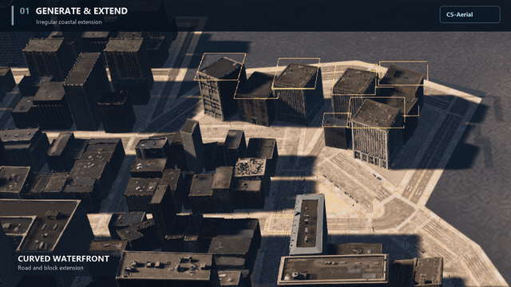
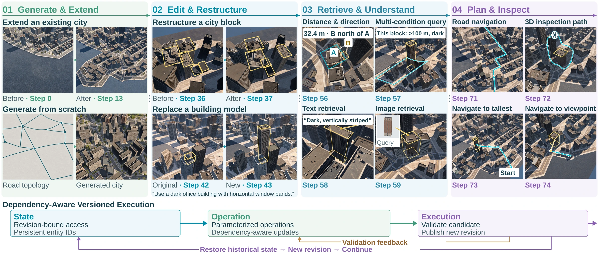

# CityCode
### Building Agent-Operable 3D Cities from Sparse Aerial Observations

[**Explore the interactive demo ↗**](https://cgjiahui.github.io/CityCode/) · [Watch the video](media/citycode-demo.mp4) · [Scene results](#scene-results) · [Agentic operations](#agentic-operations)

CityCode turns sparse low-altitude aerial observations into metric 3D cities that agents can generate, edit, query, and navigate. The input starts with **one aerial image per region**, covering approximately **400 m × 400 m**, together with camera parameters.

- Recover building structure and connect generated assets through a shared, versioned city representation.
- Support city extension, block editing, text/image retrieval, navigation, and inspection.
- Assemble scenes with **high-quality visual effects in Unreal Engine** and explore a city in the browser.

## Video

[**Watch the full 54-second video**](media/citycode-demo.mp4) — generated cities and four categories of agentic tasks, rendered in Unreal Engine. The animation above contains short excerpts from the original presentation video.

## Scene results

Comparisons on CS-Aerial, Qingdao Hospital, and Shenzhen Campus. Columns show the comparison methods, CityCode, and reference views. Open the image to inspect the details.

## Agentic operations

Selected checkpoints show city extension, building replacement, spatial queries, multimodal retrieval, road navigation, and 3D inspection. Operations update a versioned city state that can be validated and restored.

<b>Method overview</b>

Aerial observations → metric structure → structure-guided assets → shared city state → agent interaction.

## Release status

The interactive demo and selected visual results are available now. The research source and downloadable data packages are being prepared; code and data licensing will be specified with their release. Frontend dependency notices are included in [third-party notices](docs/THIRD_PARTY_NOTICES.txt).
