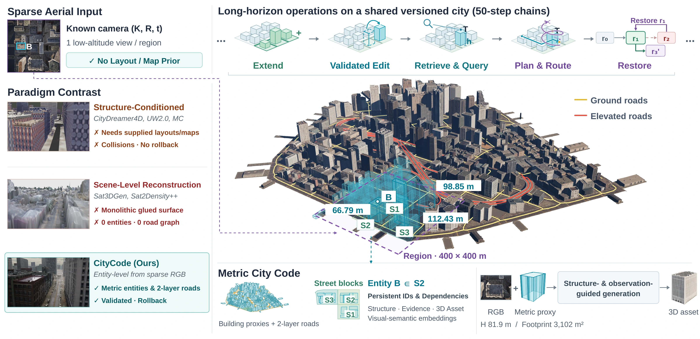
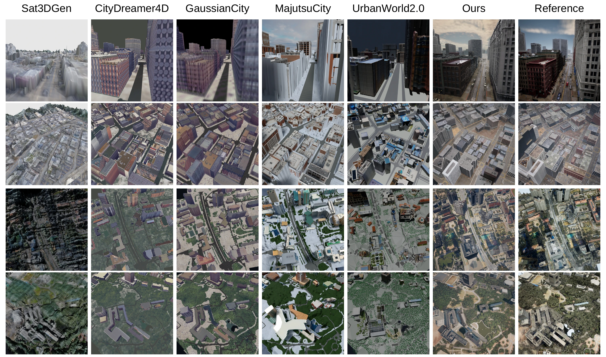
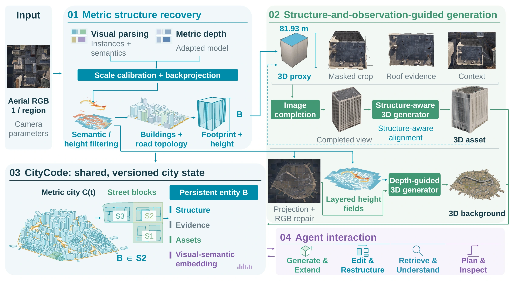

# CityCode
### Building Agent-Operable 3D Cities from Sparse Aerial Observations

<p align="center">
  <a href="https://cgjiahui.github.io/CityCode/"></a>
  <a href="https://arxiv.org/abs/2610.18342"></a>
</p>

<p align="center"><b><a href="https://cgjiahui.github.io/CityCode/">Explore the interactive city ↗</a></b> · <a href="https://cgjiahui.github.io/CityCode-Assets/">Lightweight demo</a> · <a href="https://arxiv.org/abs/2610.18342">Paper</a> · <a href="media/citycode-demo.mp4">Video</a> · <a href="#pipeline">Pipeline</a></p>

CityCode turns sparse low-altitude aerial observations into metric 3D cities that agents can generate, edit, query, and navigate. The input starts with **one aerial image per region**, covering approximately **400 m × 400 m**, together with camera parameters.

- Recover building structure and connect generated assets through a shared, versioned city representation.
- Support city extension, block editing, text/image retrieval, navigation, and inspection.
- Assemble scenes with **high-quality visual effects in Unreal Engine** and explore a reduced-quality preview in the browser.



*Air2Code uses one aerial image per region and its camera parameters to recover building geometry and ground-level and elevated roads. CityCode gives those buildings and roads persistent identities, so agents can query the city, validate edits, plan routes, and restore earlier versions.*

## Video

[](media/citycode-demo.mp4)

[**Watch the full 54-second video**](media/citycode-demo.mp4) — generated cities and four categories of agentic tasks, rendered in Unreal Engine. The animation above contains short excerpts from the original presentation video.

## Scene results



Comparisons on CS-Aerial, Qingdao Hospital, and Shenzhen Campus. Columns show the comparison methods, CityCode, and reference views. Open the image to inspect the details.

## Agentic operations


Selected checkpoints show city extension, building replacement, spatial queries, multimodal retrieval, road navigation, and 3D inspection. Operations update a versioned city state that can be validated and restored.

<details>
<summary><b>Method overview</b></summary>



Aerial observations → metric structure → structure-guided assets → shared city state → agent interaction.

</details>

## Pipeline

[Structure recovery](workflow/01_perception_structure/README.md) → [Building assets](workflow/02_building_assets/README.md) → [Background and roads](workflow/03_background_roads/README.md) → [CityCode and UE assembly](workflow/04_citycode_assembly/README.md).

```sh
python -m pip install -e .
python release/bundles.py install --profile scene
python web_preview/serve.py --port 8794
```

Research data and weights are distributed through [Hugging Face](https://huggingface.co/datasets/cgjiahui/CityCode). While private, sign in with `hf auth login` before installation. The installer restores the project directories automatically; see the [download and setup guide](release/README.md) and [data inventory](data/README.md). The repository contains the prepared pipeline code, configurations, UE adapters, tests, and preview source; it does **not** contain the large resource bundles. UE assembly also requires a compatible City Sample installation.

## License and third-party components

Project-owned source code is released under the [MIT License](LICENSE). Third-party code retains its original licenses and notices. Datasets, model weights, scene assets, and paper figures/videos are outside this source-code license; see [Third-party code and resources](THIRD_PARTY_NOTICES.md).

<details>
<summary>Third-party components used by CityCode</summary>

| Component | Purpose | License |
|---|---|---|
| MoGe v2 / DINOv2 | Depth inference and image features | MIT / Apache-2.0 |
| TRELLIS.2 / o-voxel | Building asset generation | MIT; nested Eigen files have separate terms |
| Pixal3D / NAF | Optional background generation | MIT / Apache-2.0 |
| meshoptimizer / Eigen | Geometry processing and numerical routines | MIT / primarily MPL-2.0, with file-specific notices |
| React / Three.js and browser decoders | Interactive preview | MIT, Apache-2.0 and BSD notices, depending on the component |

The original license texts, copyright notices and modification records are retained in the corresponding component directories. The [detailed notices](THIRD_PARTY_NOTICES.md) identify their locations and scope.

</details>

## Resource access

The companion research dataset is currently private and requires approved HF access. The browser demo and its reduced-quality web resource package are public. The installer checks the research upload completion marker and resource checksums before installation.
