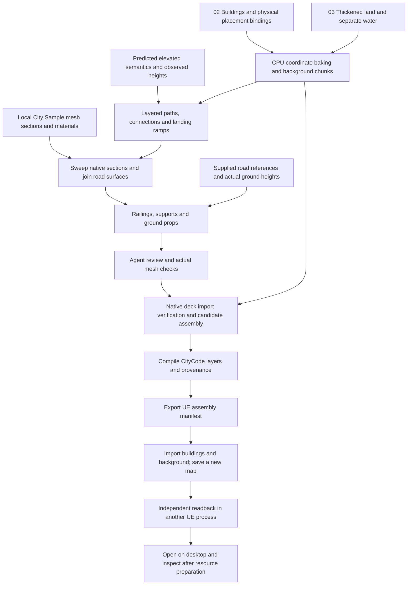

# 04: CityCode compilation and Unreal Engine assembly

This stage assembles stage02 buildings, stage03 backgrounds and predicted elevated-road structures in an existing City Sample project. Scripts handle repeatable processing; this guide covers installation, input contracts and handoff between Linux/WSL CPU preparation and Windows PowerShell UE import.

Run commands from the **release root**. Implementation lives in `pipelines/ue_citycode/` and `pipelines/scene_enrichment/`. The tested engine is **UE 5.0.3**; other versions require importer, coordinate and material validation.

The default building LOD is **0.25M**, a target budget of roughly 250,000 triangles per model. All 560 supplied placements have 0.1M and 0.25M resources. A complete 1M binding is not supplied; preparing one is described at the end.

## Workflow and inputs



| Input | Location and contents |
|---|---|
| Buildings | `data/smallcity_p384_building_assets_completed/binding_manifest_physical.json` and referenced models: 542 base placements plus 18 massing parts |
| Background | `data/smallcity_p384_background_coastal/`: thickened land, water and provenance |
| Predicted elevated roads | Recovery cache and prediction masks; assembly can directly use extracted structure/evidence in `data/smallcity_p384_scene_enrichment/` |
| Ground references | Road surfaces, directed lanes and graphs in `data/smallcity_p384_gt_roads/`; semantics/heights in `data/smallcity_p384_background_history/height/completed/` |
| Ground sampling cache | `smallcity_p384_scene_enrichment/props_ground/`: `BACKGROUND_SAMPLING.json` and three height arrays |
| Example prop decisions | Asset metadata, style, `props_reviewed_*`, `props_scene_review_candidate_groups.json` and `props_scene_review_final_*` in the enrichment directory |
| Native assets | Roads, railings, supports, vehicles and props in the user's City Sample project; supplied catalogs contain paths and dimensions, not native geometry |

Elevated-road alignment and elevation come from predicted structures, not original bridge-actor world transforms. Ground references guide vehicle/prop placement and support avoidance; their attribution remains in stage03 manifests. Native Epic geometry, materials, textures and derived bridge meshes are generated locally rather than redistributed.

## CityCode layers and conversion

`src/citycode_core/` provides the format and compiler. Invoke `pipelines/ue_citycode/citycode.py` from source, or use the installed `city-code` command. Compilation organizes accepted structures, bindings, roads and assembly results; it does not generate new models. `run_pipeline.py finalize` connects candidate assembly, CityCode compilation, UE-manifest export and CPU validation.

The public extension is **schema 2.0.0**. Historical schema 1.0.0, the last historical SmallCity data release `v1.4`, and the old library's `initial_v2` directory layout are separate version concepts. Schema 2.0.0 explicitly represents one-to-many/many-to-many structure/asset bindings, local UE resources and ground-reference inputs. Older runtimes cannot read it directly. General Agent transactions, routing and historical experiment runtimes are outside this compiler.

The local historical snapshot `data/smallcity_p384_citycode/manifest.json` is about 18 MiB and references local UE conversion files, so it is excluded from default data downloads. Running prepare, Windows import and finalize creates the user's own `final/citycode/manifest.json`:

| File | Contents |
|---|---|
| `frames.json` | Metric UE world frame, Z-up and matrix conventions; the background's separate Y/Z mapping |
| `buildings.json` | 562 structural sources, footprints, heights, observation IDs and 540 logical building groups |
| `assets.json` | Building LOD references and native City Sample resource URIs |
| `assembly.json` | 542 base plus 18 massing placements, original/reviewed matrices, 1,907 native placements and UE adapter settings |
| `roads.json` | Ground graph with 164 nodes/278 edges; 41 elevated spans, explicit connections and design-completion evidence |
| `environment.json` | Thickened land, water and background provenance |
| `relations.json` | Source/placement relationships and 249 prop groups |
| `resources.json`, `provenance.json` | Relative paths, byte sizes, SHA256 identities and actual inputs |
| `manifest.json`, `checksums.sha256` | Schema, counts, layer entries and integrity proofs |

The 562 sources and 560 model placements are different counts. Nine sources retain structural records without active placements. Composite, shared and multi-part relationships are explicit. All 41 road spans remain semantic records even when their geometry becomes one UE road-surface Actor. A road graph's 0.68 m display plane is not a measured contact height.

`manifest.schema.json` ships with `citycode_core`; validation additionally checks cross-layer references, complete transforms, grouped-part coverage, road endpoints and count consistency. `compiled` records conversion only, not a new UE run or collision check.

The following commands apply to an **already assembled local scene**, not a fresh data download:

```bash
# Freeze into a new directory; existing CityCode releases are immutable.
python pipelines/ue_citycode/citycode.py compile \
  --config workflow/04_citycode_assembly/citycode.standard.json \
  --interchange-root build/ue_citycode/interchange \
  --output build/my_citycode

python pipelines/ue_citycode/citycode.py validate \
  --scene build/my_citycode --verify-files

python pipelines/ue_citycode/citycode.py export-ue \
  --scene build/my_citycode --output build/my_citycode_ue/assembly_manifest.json

python pipelines/ue_citycode/citycode.py lookup \
  --scene build/my_citycode --id PGB_SC_000113
```

`--interchange-root` explicitly relocates Windows delivery paths and verifies their hashes. The historical Windows package reused an original filename for a filtered background; the compiler resolves its declared `background_derivative` identity rather than guessing by name. New `finalize` runs use their own paths and do not need that relocation override.

**Download the published source building GLBs and maps, or produce a new reviewed stage02 binding.** Coordinate-baked UE copies, filtered backgrounds and chunks are generated locally in `build/`; default downloads do not duplicate them or include the old local snapshot. A completed CityCode scene must remain with its referenced local files. Never substitute metadata from the example's old build directory for a new run's outputs.

Custom scenes can override bindings, original bindings, structures, assembly/catalog, road and prop inputs through the corresponding CLI options. Missing files, LODs or inconsistent identities fail. Historical conversion checks preserved 561 building/background mesh records and 1,907 native placements; this does not establish that a new end-to-end replay or UE run has occurred. Current release checks are recorded in [release/STATUS.json](../../release/STATUS.json).

## 1. Install the tested environment

### Windows engine and City Sample project

The example was verified with **Unreal Engine 5.0.3, Changelist 20979098**, and a complete City Sample project with `EngineAssociation` set to `5.0`. SmallCity is a map within that project.

1. Install [Epic Games Launcher](https://dev.epicgames.com/documentation/en-us/unreal-engine/install-unreal-engine) and select engine **5.0.3**, rather than the latest default.
2. Use the [official City Sample page](https://dev.epicgames.com/documentation/en-us/unreal-engine/city-sample-project-unreal-engine-demonstration) to obtain a complete project compatible with UE 5.0. Standalone Buildings/Vehicles packs do not contain all required resources.
3. Reuse an existing compatible project if available. Open it with 5.0.3 once, confirm that it loads, then close the editor before import. If the distribution no longer offers that project version, use an already obtained compatible copy or adapt and validate a newer version; changing the project version string alone does not establish compatibility.
4. Retain project plugins. This workflow also needs `PythonScriptPlugin`, `EditorScriptingUtilities` and `GLTFImporter`; the preflight command below enables them and backs up the project file.

The [City Sample documentation](https://dev.epicgames.com/documentation/en-us/unreal-engine/city-sample-project-unreal-engine-demonstration#recommendedsystemspecifications) lists SSD storage, 64 GB RAM, at least 8 GB VRAM and DirectX 12 recommendations. These are not a minimum-performance guarantee for the reconstructed scene. Allow additional space for model imports and DDC caches.

### CPU preparation and entry points

Linux/WSL preparation requires Python 3.10+, a C++17 compiler and stage02/03 data:

```bash
python -m pip install -e '.[scene-assembly]'
```

The optional dependency includes `manifold3d==3.5.4` for road-surface unions. This stage does not use image APIs or neural generation GPUs.

| Entry point | Operations |
|---|---|
| `run_pipeline.py prepare` | Bake coordinates, filter/chunk background, connect elevated paths, join surfaces, place railings/supports, review props and check geometry |
| `run_pipeline.py finalize` | Verify real native-deck import, compile CityCode, export assembly and rerun contact/collision/CPU checks |
| `Run-CityCode.ps1` | Windows preflight, native road export, new-deck import, full assembly and independent map readback |

Commands display plans by default. CPU commands require `--execute`; PowerShell requires `-Execute`. Use a new `build/ue_citycode_replay/` directory for a fresh run and resolve reported failures before continuing.

Open PowerShell in your CityCode checkout. Enter the Unreal Engine installation folder that contains `Engine` and the full filename of your local `CitySample.uproject` when prompted. The commands use a writable run folder under the checkout and a cache in your Windows user profile.

```powershell
Set-ExecutionPolicy -Scope Process -ExecutionPolicy Bypass -Force
$CcRoot = (Get-Location).Path   # CityCode checkout
$EngineRoot = Read-Host 'UE 5.0.3 installation folder'
$EditorDir = Join-Path $EngineRoot 'Engine\Binaries\Win64'
$SampleProject = Read-Host 'Full path to CitySample.uproject'
$CcAdapter = Join-Path $CcRoot 'pipelines\ue_citycode'
$CcRun = Join-Path $CcRoot 'build\ue_citycode_replay'
$CcWork = Join-Path $CcRun 'windows'
$CcOptions = @{
    EditorExe = (Join-Path $EditorDir 'UnrealEditor-Cmd.exe')
    Project = $SampleProject
    LocalDataCachePath = (Join-Path $env:LOCALAPPDATA 'CityCode\DDC')
    ReleaseRoot = $CcRoot
    RunRoot = $CcRun
}
& "$CcAdapter\Run-CityCode.ps1" @CcOptions -Stage preflight -EnableRequiredPlugins -Execute
```

Static checks verify actual engine/project identities; real preflight checks the editor and import plugins. Do not run a second editor on the same project. Background work defaults to `NullRHI`, exits on completion and has no fixed run-time cutoff.

| Setting | Behavior |
|---|---|
| Coordinates | Convert UE world metres to centimetres; retain building node/binding transforms; swap background Y/Z once; measure importer basis with a fixture |
| Materials/geometry | Preserve UVs, textures and material slots; enable building Nanite; save material usage and recompute missing background normals |
| Distance fields | Checks disable `r.GenerateMeshDistanceFields`; enable and revalidate it separately when rendering needs it |
| DDC/lighting | Background and desktop share DDC; saved lighting includes a 50,000 lux sun and skylight intensity 1 |
| Workers | `-Workers 4` uses sequential shards by default; `-ParallelWorkers` explicitly enables concurrency and requires sufficient RAM |

## 2. Export a native road section

Export StaticMesh local geometry and metadata from the user's City Sample project. The export does not load the original SmallCity map or read old bridge placement coordinates. The example source mesh is `SM_FREEWAY_VIS_349`:

```powershell
& "$CcAdapter\Run-CityCode.ps1" @CcOptions -Stage export-bridge -Execute
```

Copy `build/local_epic/SM_FREEWAY_VIS_349_987f07977f.obj` back to the CPU workspace at the same relative path. The template uses dimensions and four material slots from `ue_source_asset_catalog.json`. For a different project version, the lower-level `invoke_editor.ps1 -Action export_catalog` accepts a job with explicit `mesh_paths` to rebuild metadata. Missing assets/materials require rebinding and review, not an empty replacement mesh.

## 3. Prepare buildings, background and road network

After copying the source OBJ into `build/local_epic/`, run:

```bash
python pipelines/ue_citycode/run_pipeline.py prepare \
  --run-root build/ue_citycode_replay \
  --source-obj build/local_epic/SM_FREEWAY_VIS_349_987f07977f.obj \
  --lod 0.25M --workers 3 --execute
```

This command covers coordinate baking, filtering/chunking, network connections, surface union and the checks described in section 4. Missing inputs and failed checks stop execution.

Assembly normally consumes the supplied `elevated_structure.json`. Optional extraction replay uses `scene_enrichment/extract_elevated.py` and `validate_elevated.py`.

Background filtering changes the UE copy only: remove old elevated surfaces under the predicted elevated mask, retaining ground, thickened land and separate water. Chunking preserves texture and remaining triangles without another coordinate swap.

Network connections respect explicit layers, not XY intersections. Junctions align height/tangents, and solid union removes internal caps and overlapping road surfaces while preserving UVs/materials. Landing ramps blend toward the actual ground cross-slope over their final 15 m and embed about 2.5 cm at the endpoint; top and bottom deform together to retain thickness.

The example has **23 retained spans + 11 continuity connections + 2 design completions + 5 landing ramps = 41 spans**, plus one retained span adjusted in place. Two isolated short fragments remain deferred. The two design completions are declared as inferred connections, not observed roads. There are 329 logical surface sections but one joined road-surface Actor. Profile constraints use 10% slope; actual curves are checked against a 13% upper bound.

## 4. Supports, railings, street props and review

Preparation first avoids the reviewed candidate prop footprints when placing supports, then rechecks ground props against the final road mesh. `props_scene_review_candidate_groups.json` is an avoidance input, not the final placement result. Outputs are written to the new run directory.

`prepare` runs these operations automatically. Reports containing failures or `requires_review` stop the workflow.

Supports contact the actual downward-facing road triangles. Railings follow road edges and landing cross-slopes and are suppressed inside junctions. Vehicles align with directed lanes, with body and glass sharing a group transform. Lamps, signals, trees, benches and bins use their respective road semantics.

| Implementation | Responsibility |
|---|---|
| `scene_enrichment/props.py` | Generate layouts from surfaces, lanes, heights, buildings and catalogs; configurable binding, sections, lanes, graph, background, land, semantics, catalog, style and ground cache |
| `scene_enrichment/review_props.py --replay <decisions>` | Replay frozen local avoidance decisions and verify their input identities |
| `scene_enrichment/review_scene_props.py` | Recheck props against actual roads/ground, trying small tilts and along-road shifts before deferral |
| `scene_enrichment/props_scene_qa.py` | Check groups, orientation, contact and building/support/railing/deck occupancy |
| `ue_citycode/audit_elevated_geometry.py` | Test actual road/building mesh intersections and sampled containment |
| `ue_citycode/audit_elevated_landings.py` | Ray-check landing cross-sections against actual ground triangles |

For a new scene, generate a layout, review it with scene evidence and freeze new decisions. The two review scripts include **example-specific prop IDs and decisions**; they are not a generic autonomous approval service. Do not apply old removal IDs to new inputs.

The accepted example contains 249 prop groups and 306 mesh parts: 57 cars, each with body/glass, 65 lamps, 38 signals, 35 trees, 23 benches and 31 bins. Ten cars received contact-tilt adjustments. Two lamps and one car conflicting with new ramps were deferred after local shifts failed; positions, attempted changes and reasons remain recorded. Ground-contact proxies do not establish exact wheel contact or traffic simulation readiness.

## 5. Import native decks and freeze the final manifest

Copy `build/ue_citycode_replay/surfaces/joined/` to the corresponding Windows path:

```powershell
& "$CcAdapter\Run-CityCode.ps1" @CcOptions -Stage import-bridge -Execute
```

This must execute in UE to verify actual material slots, imported dimensions and geometry identities. Copy `$CcWork/native_bridge_catalog.json` and `$CcWork/native_bridge_proposal.json` back to the CPU run's `build/ue_citycode_replay/windows/`, then finalize:

```bash
python pipelines/ue_citycode/run_pipeline.py finalize \
  --run-root build/ue_citycode_replay --execute
```

Finalization verifies the successful prepare record, artifact hashes and actual imported native resources. It produces `final/assembly_manifest.json`, regenerates final railings/supports and reruns prop, landing, building-intersection and full CPU geometry checks. Failed checks block assembly.

## 6. Assemble and independently read back the map

Copy the entire CPU `build/ue_citycode_replay/` tree to Windows `$CcRun`, preserving relative layout. It must contain referenced files under `base/interchange/`, `final/`, `surfaces/` and `enrichment/`; copying only the manifest is insufficient. Preserve Windows-generated `windows/` import results and reuse the existing City Sample project.

```powershell
# Display the plan without starting UE.
& "$CcAdapter\Run-CityCode.ps1" @CcOptions -Stage assemble -Workers 4
# Execute the complete assembly.
& "$CcAdapter\Run-CityCode.ps1" @CcOptions -Stage assemble -Workers 4 -Execute
```

The launcher runs import workers, `finish_windows.ps1` and independent `ue_readback.py`. It reuses imports by content identity, imports buildings/chunked background, saves a new map and reopens it in another UE process. `citycode_workers.json` records shards; `task_status.json` records finalization progress. Only successful independent readback marks completion; process exit or a quiet log alone is insufficient.

New resources/maps use `/Game/Research/CityCodeOpenSource/`. Normal import saves textures, material usage, background-normal settings and inspection lighting/sky. Open the saved map from the Windows interactive desktop:

```powershell
& powershell.exe -NoProfile -ExecutionPolicy Bypass -File "$CcAdapter\Open-CityCode.ps1" `
    -EditorExe (Join-Path $EditorDir 'UnrealEditor.exe') `
    -Project $CcOptions.Project -AssemblyResult "$CcWork\assemble_result.json" `
    -ReadbackResult "$CcWork\readback_result.json" -LocalDataCachePath $CcOptions.LocalDataCachePath
```

Wait for shader, texture, static-mesh and surface-cache preparation to finish before assessing the scene. Temporary gray materials can resolve during that preparation. Persistent missing materials should be investigated through import/readback errors rather than hidden with exposure changes.

`pipelines/ue_citycode/ue_render.py` supports remote offscreen `capture_mode: base_color` for material/geometry/assembly inspection; wait for the complete PNG before review. UE 5.0 SceneCapture2D does not reproduce main-viewport Lumen indirect lighting, as discussed in [Epic's 5.1 release notes](https://dev.epicgames.com/documentation/en-us/unreal-engine/unreal-engine-5.1-release-notes?application_version=5.1). Use the interactive desktop or `mode: viewport` to assess final lighting. An SSH session may lack a normal window swap chain; this alone does not identify a scene/material defect. Inspection scripts do not save the level.

## 7. Validation and historical accepted result

| Layer | Required checks |
|---|---|
| CPU data | Model/binding/background/template identities match; no missing LODs, unresolved assets or diagnostic-only subset |
| Geometry | Continuous same-layer seams, valid surface union, distinct elevation layers, actual-ground landings and no unresolved severe building/prop conflicts |
| Saved UE result | Independent readback matches meshes, materials, Nanite, provenance, transforms, bounds and building groups; lighting/background-normal checks pass |
| Visual inspection | Inspect the full city, junctions, ramps and props after resources are ready; readback does not replace this review |

The accepted example revision completed independent readback on **2026-10-23** and received user visual approval. It retained 560 building placements, joined the 41 road spans into one Actor, and included 1,489 railing sections, 111 supports and 306 prop mesh parts. Readback found 2,706 manifest-tagged mesh Actors and 545 building-group roots with zero errors; these are not counts of new buildings. Road/building mesh checks found no intersections, and 25 actual-ground samples across five new landings met the 5 cm target tolerance.

Historical local evidence is under `build/ue_citycode_elevated_repair/windows_results/`, for map `CityCode_d6c4415eea92_ElevatedRepair_v3`. It is not a required download. New runs produce their own scene identities, map names and readback records. Static checks do not configure dynamic vehicle traffic or certify UE physics simulation.

For an existing example map, `apply_elevated_repair.py` and `invoke_elevated_repair.ps1` provide incremental repair tied to its manifest, result, independent readback and geometry snapshot. They save a separate copy before changes and reread it afterward. This is not a prerequisite for first import; new users follow sections 1-6.

## 8. Optional 1M building geometry

0.1M, 0.25M and 1M are per-model target triangle budgets, not file sizes or guarantees of exact face counts. Higher geometry increases import, memory and loading costs; it neither raises texture resolution automatically nor restores details absent from the generated source mesh.

The supplied bindings do not contain a complete 1M set. Use [stage02](../02_building_assets/README.md) to export 1M from independent original generation outputs, review every LOD, associate the models and create a new physical binding. Reused massing `donor_lods` also need 1M entries. Subdividing a 0.25M model is not a new high-detail result.

```bash
python pipelines/ue_citycode/run_pipeline.py prepare \
  --run-root build/ue_citycode_1m \
  --source-obj build/local_epic/SM_FREEWAY_VIS_349_987f07977f.obj \
  --lod 1M --binding data/my_city/binding_manifest_physical.json \
  --workers 3 --execute
```

Use that same new run directory for Windows deck import, CPU finalize and UE assembly. The entry forwards the chosen LOD/binding to preparation and checks. Missing files, identities or donor variants are reported together; there is no silent fallback to 0.25M. If original full-resolution outputs are unavailable, regenerate the corresponding stage02 units first.

New 1M geometry requires fresh scene/prop review and frozen decisions; the example's prior approval does not automatically cover it. Retain the original 0.25M version for comparison and rollback.
